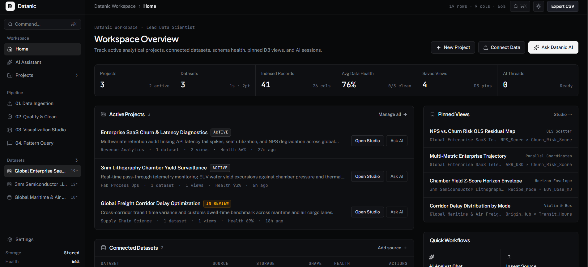
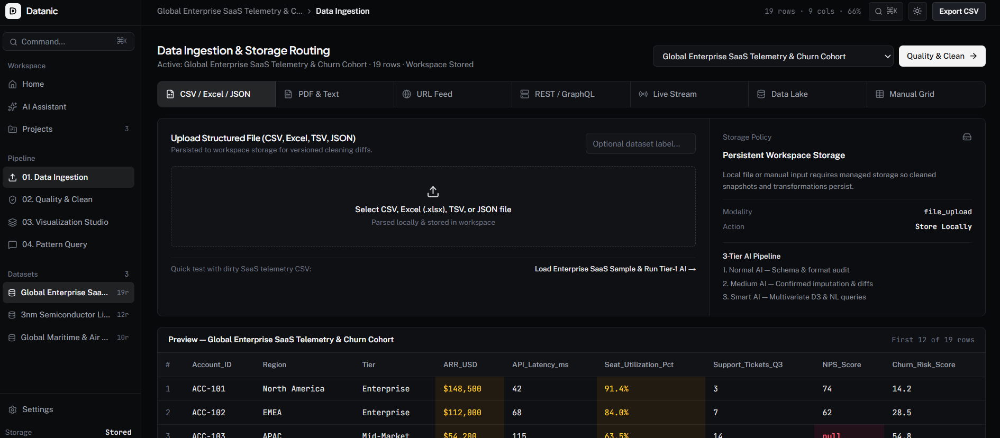
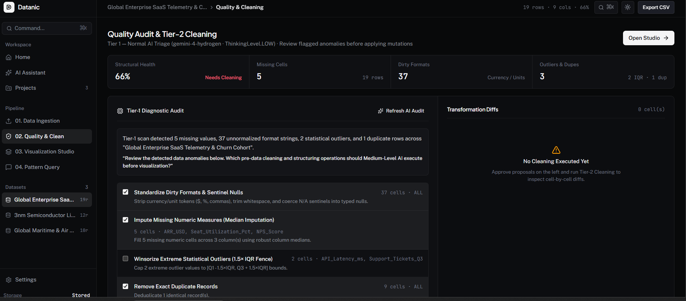
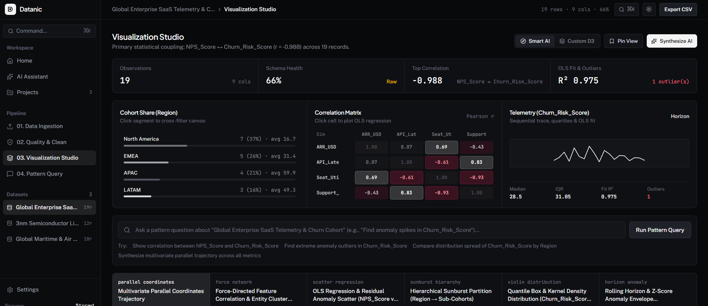
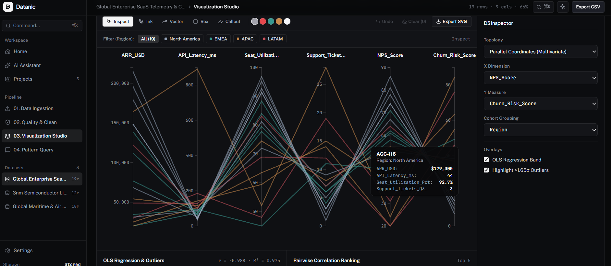

<div align="center">

# Datanic

**Interactive Data Intelligence, Tiered AI Cleaning & D3.js Visualization Workspace**

An all-in-one enterprise analytics workspace for data scientists, analytics engineers, and data analysts — combining multi-modal ingestion, intelligent storage routing, human-in-the-loop AI data cleaning, multivariate D3.js visualizations, canvas annotation tools, and conversational AI discovery.


</div>

---



## Overview

**Datanic** streamlines the entire analytical workflow from raw, messy inputs to interactive visual discovery in a single monochrome, keyboard-first workspace:

1. **Ingest Anything, Store Only What You Must** — Connect structured files (CSV, Excel `.xlsx`, TSV, JSON), unstructured PDF/text documents, URL feeds, REST/GraphQL APIs, live telemetry streams, data lakes, or manual grid entries. Local files are persisted in workspace storage, while remote URLs, APIs, streams, and data lakes operate via **zero-copy pass-through**.
2. **Human-in-the-Loop 3-Tier AI Pipeline** — Diagnose schema health and anomalies with fast Tier-1 triage, confirm transformations before Tier-2 cleaning executes with cell-by-cell diffs, and uncover unexpected multivariate relationships with Tier-3 Smart AI synthesis.
3. **Interactive D3.js Visualization & Annotation Studio** — Explore data across 7 custom D3 topologies with live cohort cross-filtering, OLS regression & Z-score outlier overlays, SVG drawing/callout tools, and one-click SVG/CSV exports.
4. **Conversational AI Assistant & Natural Language Pattern Queries** — Chat with a streaming, dataset-grounded AI data scientist (with configurable reasoning depth and snippet attachment) or query patterns directly from the visualization studio and `⌘K` Command Palette.

---

## Product Showcase

### 1. Multi-Modal Data Ingestion & Storage Routing
Accepts 7 distinct data modalities with automatic storage policy routing (**Persistent Workspace Storage** for local uploads vs. **Zero-Copy Pass-Through** for external URLs, APIs, streams, and data lakes) and instant schema preview highlighting nulls and dirty formats.



### 2. Tier-1 Quality Audit & Tier-2 Interactive Cleaning
Automatically scans structural health, missing cells, currency/unit strings, statistical outliers (`1.5× IQR` / Z-score), and duplicate records. Analysts review and approve specific remediation proposals (plus custom instructions) before applying mutations, with full cell-by-cell transformation diffs and rollback to raw snapshots.



### 3. Visualization Studio, Bento Telemetry & Pattern Queries
Combines a hairline KPI telemetry strip, interactive cohort cross-filtering, clickable Pearson correlation matrix, sequential sparkline telemetry, natural language pattern querying, and Smart AI perspective recommendations.



### 4. Interactive D3.js Canvas, Inspector & Annotation Tools
Render high-density multivariate graphics directly in D3.js with interactive hover tooltips, cohort filters, OLS regression bands, outlier markers, and built-in vector annotation tools (**Inspect**, **Freehand Ink**, **Vector Line**, **Highlight Box**, and **Text Callouts**) with SVG export and **Pin View** persistence.



---

## Key Features

- **Workspace Home & Project Management**: Track active projects, connected datasets, indexed record counts, average schema health, pinned D3 views, AI threads, and live workspace activity.
- **AI Assistant Page**: ChatGPT/Claude-style conversational workspace with thread history, dynamic dataset-grounded prompt starters, dataset scope selector (`Single Dataset` or `All Workspace Datasets`), reasoning depth selector (`Fast`, `Balanced`, `Deep`), raw CSV/JSON snippet attachment, and SSE streaming Markdown/code rendering.
- **7 Interactive D3.js Topologies**:
  - Parallel Coordinates (Multivariate Trajectory)
  - Force-Directed Feature Correlation & Entity Network
  - OLS Regression & Residual Anomaly Scatter
  - Hierarchical Sunburst Partition
  - Quantile Box & Kernel Density Violin Distribution
  - Rolling Horizon & Z-Score Anomaly Envelope
  - Aggregated Cohort Comparison Bar Chart
- **Canvas Drawing & Export Tools**: Annotate directly on top of live D3 charts with freehand ink, vector lines, bounding boxes, and pinned callout labels; export annotated SVGs or cleaned CSV datasets.
- **Command Palette (`⌘K` / `Ctrl+K`)**: Jump across pages, switch datasets, launch any D3 topology, toggle themes, export CSV, or dispatch prompts directly to the AI Assistant.
- **Dual Theme & Workspace Settings**: Instant switch between **Obsidian Dark** and **Porcelain Light**, plus configurable startup page, table density, storage routing policy, outlier Z-score sensitivity, AI reasoning defaults, and workspace JSON backup/reset.

---

## Architecture & 3-Tier AI Pipeline

Datanic runs as a full-stack TypeScript application with an Express server (`server.ts`) hosting both the Vite React frontend and server-side `/api/*` routes.

| Stage | AI Tier / Reasoning | Server Endpoint | Purpose |
| :--- | :--- | :--- | :--- |
| **Unstructured Extraction** | Tier 1 (`ThinkingLevel.LOW`) | `POST /api/ai/parse-unstructured` | Extracts structured tabular rows from pasted PDF/report text |
| **Quality Triage** | Tier 1 (`ThinkingLevel.LOW`) | `POST /api/ai/diagnose` | Audits schema health, missingness, dirty formats & proposes fixes |
| **Data Cleaning** | Tier 2 (`ThinkingLevel.MEDIUM`) | `POST /api/ai/clean` | Executes approved remediation rules & generates audit notes |
| **Smart Discovery** | Tier 3 (`ThinkingLevel.HIGH`) | `POST /api/ai/discover` | Uncovers hidden correlations & recommends non-obvious D3 views |
| **Pattern Query** | Tier 3 (`ThinkingLevel.HIGH`) | `POST /api/ai/query` | Translates natural language questions into filters & chart configs |
| **AI Assistant Chat** | Configurable (`LOW` / `MEDIUM` / `HIGH`) | `POST /api/ai/assistant` | Streaming SSE multi-turn data science assistant grounded in live context |
| **Zero-Copy Proxy** | — | `POST /api/proxy/fetch` | Fetches external HTTP/HTTPS JSON & CSV endpoints without CORS issues |
| **Workspace Storage** | — | `GET/POST/DELETE /api/storage/datasets` | Persists local/uploaded datasets while bypassing storage for pass-through URIs |

---

## Tech Stack

- **Frontend**: React 19, TypeScript, Tailwind CSS v4, Lucide Icons, Motion
- **Data Visualization**: D3.js v7 (custom responsive SVG topologies + annotation overlay)
- **Data Parsing**: SheetJS (`xlsx`), PapaParse (`papaparse`), custom statistical engine (Pearson correlation, OLS regression, IQR/Z-score anomaly detection)
- **Backend & AI**: Node.js, Express, `@google/genai` SDK (server-side only), Vite 8 middleware

---

## Getting Started

### Prerequisites

- **Node.js** `>= 20`
- **npm** `>= 10`
- A **Gemini API Key** (optional for deterministic local statistics & D3 visualizations; required for live AI Assistant streaming and server-side Gemini tiers)

### Installation

```bash
# 1. Clone the repository
git clone <your-repository-url>
cd <repository-folder>

# 2. Install dependencies
npm install

# 3. Configure environment variables
cp .env.example .env
```

Edit `.env` and set your `GEMINI_API_KEY`:

```env
GEMINI_API_KEY="your_gemini_api_key_here"
```

### Running Locally

```bash
# Start full-stack development server (Express + Vite on http://localhost:3000)
npm run dev
```

### Production Build & Verification

```bash
# Type-check with TypeScript
npm run lint

# Build production bundle
npm run build

# Run core data engine unit tests
npx tsx --test src/utils/dataEngine.test.ts

# Start production server
NODE_ENV=production npm start
```

---

## Project Structure

```text
├── server.ts                         # Express backend, zero-copy proxy, storage & Gemini AI routes
├── index.html                        # Entry HTML & typography metadata
├── public/assets/aistudio/           # Application screenshots for documentation
└── src/
    ├── App.tsx                       # Multi-page state, localStorage persistence & Cmd+K wiring
    ├── types/workspace.ts            # Core TypeScript domain models
    ├── utils/
    │   ├── dataEngine.ts             # Statistical profiling, cleaning engine, OLS, correlations & NL fallback
    │   ├── dataEngine.test.ts        # Node test suite for storage policy, parsing, cleaning & stats
    │   ├── sampleDatasets.ts         # Built-in Enterprise SaaS, 3nm Fab & Freight Corridor datasets
    │   └── workspaceDefaults.ts      # Seed projects, pinned D3 views, activity & default settings
    └── components/
        ├── HomeDashboard.tsx         # Workspace Overview (default landing page)
        ├── AIAssistantPage.tsx       # Streaming ChatGPT/Claude-style conversational analyst
        ├── ProjectsPage.tsx          # Projects & Pinned D3 Views management
        ├── IngestionHub.tsx          # 7-modality data ingestion & storage policy routing
        ├── CleaningWorkbench.tsx     # Tier-1 audit, approval checklist & cell-level diff viewer
        ├── VisualizationStudio.tsx   # Telemetry Bento, Smart AI cards, NL query & D3 studio
        ├── D3InteractiveCanvas.tsx   # 7 D3.js charts + interactive SVG drawing & callout layer
        ├── BentoOverview.tsx         # Cohort share bars, correlation matrix & sparkline telemetry
        ├── SettingsPage.tsx          # Workspace, theme, storage routing & AI behavior settings
        ├── EnterpriseSidebar.tsx     # Compact Linear-style navigation rail & dataset switcher
        └── CommandPalette.tsx        # Global Cmd+K / Ctrl+K command launcher
```

---

## License

Licensed under the [Apache License 2.0](https://www.apache.org/licenses/LICENSE-2.0).
